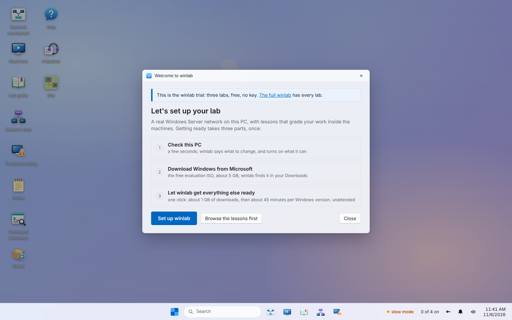
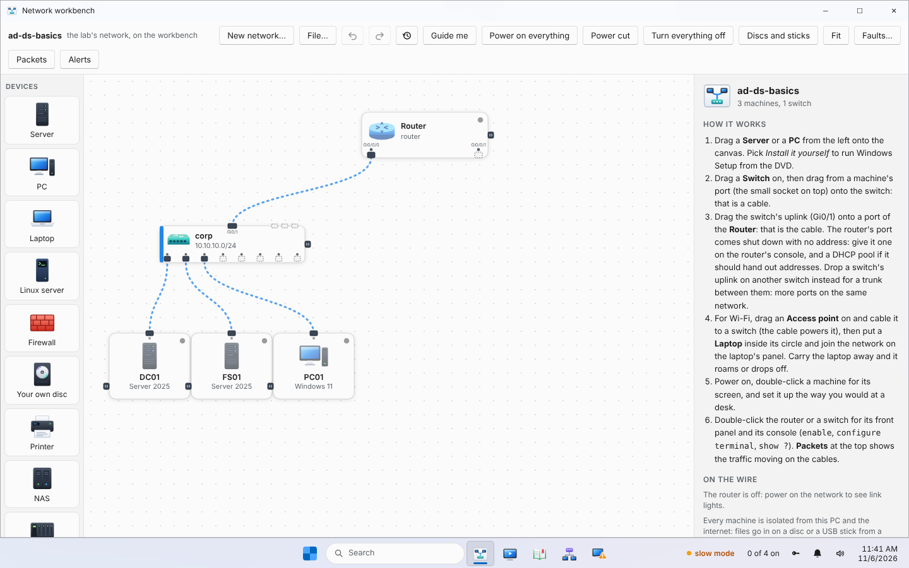
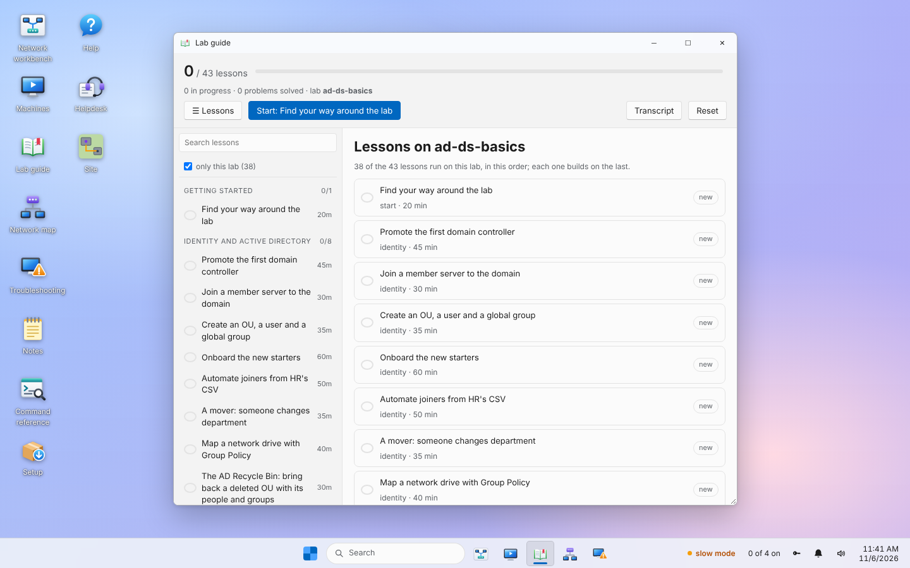
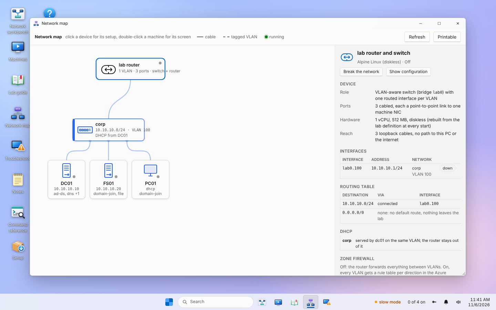

# winlab trial

A free trial of **winlab**: a portable, isolated Windows Server and network
lab for your PC. Real Windows machines from Microsoft's free evaluation
media, routers and switches you configure at their consoles, a firewall you
install yourself, and lessons that grade the work you do inside them.

The trial has three labs:

- **ad-ds-basics**: dc01 (AD DS, DNS, DHCP), fs01 (file server) and pc01
  (Windows 11), with the lab's switch and router on the workbench;
- **firewall-by-hand**: install OPNsense (or pfSense CE) on a two-port PC,
  set it up from a Windows PC's browser, write the first rules;
- **router-protocols**: the lab router at its console: OSPF, eBGP to an
  ISP, a guest network in a VRF, VRRP.

43 lessons with Check my work (see CURRICULUM.md), the Troubleshooting
drills with a three-step hint ladder, the helpdesk queue, Notes, the Command
reference, Settings and Help. No product key is needed.

Every lab runs in total isolation: no path from the lab to your PC or the
internet.

**The full winlab** has every lab (Windows 11 deployment, ConfigMgr, PKI,
clusters, Hyper-V, mail, web farms, SAN, security operations and more), the
whole hardware workbench, scenarios, exam prep and updates:
https://smartcartapp.net/pricing

## Screenshots

The desktop the first time it opens, with the trial notice and the guided setup:

The network workbench: the lab's machines, switch and router, cabled. Double-click
the router or the switch for its front panel and its console.

The lessons, in order; each one is checked inside the machines:

The network map: every device, its addresses, routes and DHCP:

## Install

Run `winlab-core-<version>-setup.exe` from the Releases page (or unzip
`winlab-core-<version>-win64.zip` into a folder you own) and choose
**Set up winlab** on the welcome screen.

Requirements: 64-bit Windows 10 or 11, virtualization turned on, 4+ cores,
16 GB RAM for the whole lab (8 GB runs one lesson's machines with the
Low-memory profile), about 40 GB free disk, and internet once for setup.

## From source

Python 3.11+, standard library only:

    python -m winlab setup
    python -m winlab gui ad-ds-basics

Tests: `python tests/test_winlab.py`.

## Building the installer

On Windows with Inno Setup 6.3+:

    powershell -ExecutionPolicy Bypass -File packaging\build-exe.ps1 -Edition core

It writes `dist\winlab-core-<version>-setup.exe` and `-win64.zip`.

**Releases:** publish a release on GitHub's Releases page (tag it with the
version, e.g. `v0.2.0`) and `.github/workflows/release.yml` builds the
installer and the zip on Windows and attaches them to that release in about
15 minutes. Pushing a tag `core-v<version>` does the same and creates the
release itself; running the workflow by hand keeps the files as the run's
artifact.

## What winlab does not ship

QEMU, the DSC resource modules, the virtio drivers, the console viewer,
OPNsense, Ubuntu and Windows itself are fetched onto your PC at setup, never
bundled. See LICENSING.md.
